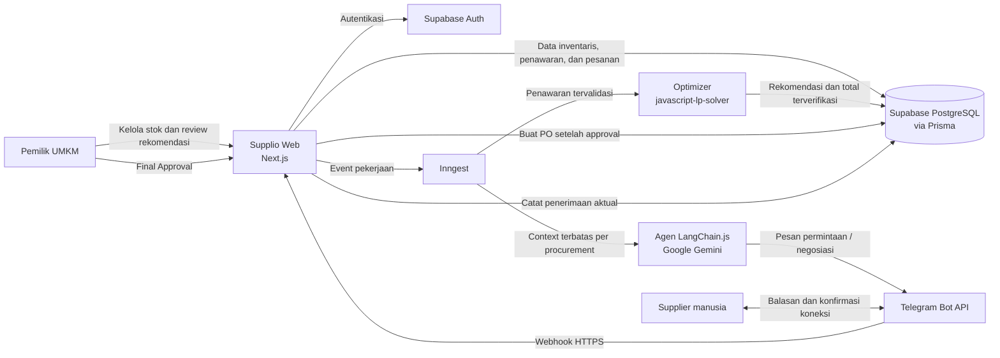

# Supplio

**Kategori:** Web 
**Nama aplikasi:** Supplio 
**Tim:** An Tech A Sync 
**Anggota:** Zaidan Daffa Abdillah, Muhammad Mulnawarman 
**Subtema:** Local MSME and Creative Economy

Supplio adalah aplikasi web inventaris dan pengadaan berbantuan AI untuk UMKM. Aplikasi ini membantu pemilik usaha memantau stok, mengetahui kapan perlu restock, meminta penawaran kepada supplier, dan membandingkan total biaya sebelum memutuskan pembelian. Supplio ditujukan untuk pemilik dan pengelola UMKM yang mengatur inventaris serta pengadaan secara langsung.

Masalah yang diangkat adalah pencatatan stok dan pencarian penawaran yang sering dilakukan manual, sehingga kebutuhan restock dapat terlambat dan biaya dari beberapa supplier sulit dibandingkan. Supplio menggabungkan pemantauan stok, komunikasi penawaran melalui Telegram, dan rekomendasi pembelian dalam satu alur. AI membantu memahami dan menegosiasikan penawaran; pemilik tetap menyetujui keputusan pembelian.

## Fitur yang sudah diimplementasikan

- Mengelola produk, stok, konsumsi harian, batas restock, lead time, safety stock, dan batas harga.
- Mencatat pergerakan stok masuk, keluar, dan penyesuaian serta menghitung posisi stok dan kebutuhan restock.
- Membuat permintaan penawaran otomatis berdasarkan kebutuhan stok atau secara manual dari pilihan pemilik.
- Mengelola supplier dan onboarding supplier melalui Telegram Bot API dengan persetujuan pemilik.
- Memproses balasan supplier dengan agen Gemini, meminta klarifikasi bila informasi penawaran belum lengkap, dan membatasi negosiasi.
- Mengoptimalkan kombinasi penawaran berdasarkan kebutuhan, harga, ongkir, anggaran, stok supplier, MOQ, dan waktu pengiriman.
- Menampilkan rekomendasi untuk disetujui atau ditolak pemilik; membuat purchase order setelah approval dan mencatat penerimaan barang, termasuk penerimaan sebagian.

## Teknologi

| Bagian | Teknologi |
|---|---|
| Aplikasi web dan API | Next.js App Router, React, TypeScript |
| Antarmuka | Tailwind CSS, shadcn, Base UI, Lucide |
| Database dan autentikasi | Supabase PostgreSQL, Supabase Auth, Prisma |
| Pemrosesan bahasa | LangChain.js, Google Gemini API |
| Komunikasi supplier | Telegram Bot API |
| Pekerjaan latar belakang | Inngest |
| Optimasi dan validasi | `javascript-lp-solver`, Decimal.js, Zod |
| Pengujian | Vitest |
| Deployment yang dikonfigurasi | Vercel, Supabase, Inngest |

## Arsitektur dan alur data

Data inventaris dan proses pengadaan disimpan di PostgreSQL. Supplio mengirim permintaan penawaran kepada supplier yang telah terhubung dan disetujui melalui Telegram. Webhook menyimpan balasan, lalu Inngest menjalankan pemrosesan secara terpisah. AI mengekstrak informasi penawaran; backend memvalidasi data dan optimizer deterministik menghitung rekomendasi. Purchase order hanya dibuat setelah pemilik menyetujui rekomendasi.

## Akun demonstrasi

Aplikasi menggunakan Supabase Auth. Gunakan akun demonstrasi berikut pada lingkungan demo Supplio:

| Email | Kata sandi |
|---|---|
| `demo@supplio.test` | `aZ_4ogEnF4-NM8stoqhs` |

Untuk menjalankan secara lokal, buat user owner di Supabase Auth milik Anda sendiri dan gunakan UUID-nya untuk mengisi `SEED_OWNER_USER_ID` sebelum menjalankan seed. Seluruh data seed adalah simulasi.

## Atribusi

- Empat foto landing page berasal dari Pexels; nama kreator, tautan foto, dan informasi lisensi dicatat di [`public/landing/assets/photos/SOURCES.md`](public/landing/assets/photos/SOURCES.md). Foto digunakan sebagai ilustrasi dan tidak menyiratkan dukungan terhadap Supplio.
- Template referensi `maroon-fintech-landing` oleh Kedhareswer Naidu berlisensi MIT dan disertakan dalam `fintech-saas-landing-page-template-v1.zip`.
- Data awal dari `prisma/seed.ts` adalah data simulasi yang dibuat untuk demonstrasi, bukan data supplier atau harga nyata.
- Framework, library, API, dan layanan pihak ketiga yang digunakan tercantum pada tabel teknologi dan `package.json`; kode sumber dan aset masing-masing tunduk pada lisensi serta ketentuan penyedianya. Tidak ada dataset eksternal yang digunakan.

Sumber kebenaran kebutuhan dan batas produk: [SUPPLIO.md](SUPPLIO.md).

## Setup lokal

1. `npm install` (otomatis menjalankan `prisma generate`)
2. Salin `.env.example` ke `.env.local` dan isi nilainya.
3. Buat satu user owner di Supabase Auth (Dashboard → Authentication → Users).
4. Terapkan migrasi: `npm run db:migrate`
5. (Opsional) Isi data demo: isi `SEED_OWNER_USER_ID` dengan UUID user tadi, lalu `npm run db:seed`.
   Seluruh data seed adalah **simulasi**.
6. `npm run dev`

## Telegram & Inngest

Supplier adalah manusia yang membalas lewat **Telegram Bot API** (bukan akun personal pemilik).

1. Buat bot di [@BotFather](https://t.me/BotFather). Isi `TELEGRAM_BOT_TOKEN` dan `TELEGRAM_BOT_USERNAME` (tanpa `@`) di `.env.local`.
2. Buat secret webhook acak untuk `TELEGRAM_WEBHOOK_SECRET`:
   `node -e "console.log(require('crypto').randomBytes(24).toString('base64url'))"`
3. Telegram butuh URL **HTTPS publik**. Saat dev lokal, ekspos port 3000 lewat tunnel (cloudflared/ngrok), lalu:
   `npm run telegram:webhook -- set https://url-tunnel-anda.example`
   Cek dengan `npm run telegram:webhook -- info` (juga menampilkan username bot).
4. Alur onboarding supplier: halaman **Supplier** → *Hubungkan Telegram* → kirim tautan ke supplier → supplier membuka tautan,
   menekan Start, lalu menekan tombol persetujuan. Tautan sekali pakai dan kedaluwarsa (`TELEGRAM_LINK_TOKEN_TTL_HOURS`).
   Bot tidak bisa memulai chat sebelum supplier melakukan langkah ini.
5. **Inngest** menjalankan outreach, penantian balasan (timeout `responseTimeoutMinutes`), dan optimasi. Lokal:
   `npx inngest-cli@latest dev` lalu jalankan app dengan `INNGEST_DEV=1`. Produksi: `INNGEST_EVENT_KEY` dan `INNGEST_SIGNING_KEY`.
   Tanpa Inngest, pesan Telegram tetap diproses lewat jalur cadangan, tetapi sourcing otomatis tidak berjalan.

Pesan di webhook hanya disimpan lalu dijawab 2xx; pemrosesan berjalan terpisah dan idempotent (deduplikasi `update_id`).

## Agen AI (Gemini)

Balasan supplier diproses satu per satu oleh agen LangChain.js (`src/lib/ai/`), dijalankan Inngest, bukan di webhook.
LLM: Google Gemini (`GEMINI_API_KEY`, `GEMINI_MODEL`, default `gemini-2.5-flash`).

- **Model hanya memahami bahasa dan menyusun pesan.** Aturan keselamatan ditegakkan KODE: maksimal satu counter-offer per
  supplier (juga CHECK di database), batas klarifikasi dan jumlah pesan, satu pesan per giliran, penjaga pesan keluar
  (budget, harga maksimum, nama supplier lain, komitmen pembelian, tautan), serta status penawaran dan sesi.
- Tool yang tersedia hanya `getProcurementContext`, `getEligibleSuppliers`, `getConversationHistory`, `saveQuotation`,
  `sendSupplierMessage`; semuanya terikat `businessId`/`requestId`/`sessionId` dari backend. Tidak ada tool untuk
  menyetujui pembelian atau mengubah budget.
- Pesan supplier adalah data tidak tepercaya (dibungkus `<supplier_message>` dan di-escape). Data yang tidak tegas
  ("sekitar 17 ribu") menjadi `NEEDS_CLARIFICATION` dan tidak pernah masuk optimasi.
- **Kuota:** Free Tier Gemini hanya 5 permintaan/menit/model, dan satu giliran memakai 2-4 panggilan. Saat 429, Inngest
  menunggu sesuai petunjuk Google lalu mengulang (giliran idempoten). Untuk beberapa supplier sekaligus gunakan tier berbayar.
- Tes memakai model palsu (`npm test`, `npm run test:integration`). `npm run test:live` memanggil Gemini sungguhan
  (3 skenario, beberapa panggilan); jalankan seperlunya agar tidak menghabiskan kuota.

## Persetujuan, PO, dan penerimaan barang

Setelah optimasi menghasilkan rekomendasi (status `AWAITING_APPROVAL`), tidak ada pesanan sebelum pemilik menyetujui
di `/procurement/[id]`.

- `POST /api/procurement/[id]/approve` (hanya pemilik terautentikasi; body strict, `businessId` tidak bisa disuntik).
  Sebelum PO dibuat, rekomendasi divalidasi ulang terhadap data terbaru (harga, ongkir, total, budget, MOQ). Bila ada
  yang berubah, request kembali ke `OPTIMIZING`, optimasi diulang, dan respons 409 `REVALIDATION_FAILED`. Persetujuan
  ganda/bersamaan menghasilkan satu set PO (idempotent, row lock).
- Satu PO per supplier terpilih; konfirmasi pesanan dikirim ke supplier via Telegram lewat event Inngest
  `procurement/approved` (jalur cadangan: `after()` langsung). `POST /api/purchase-orders/[id]/send` mengirim ulang.
- `POST /api/procurement/[id]/reject` membatalkan request dan menutup sesi sourcing yang masih berjalan.
- `/receiving` dan `POST /api/purchase-orders/[id]/receipts`: catat barang yang benar-benar diterima (kunci idempotensi
  wajib). Stok bertambah hanya sebesar jumlah yang diterima, tidak boleh melebihi sisa pesanan. Penerimaan sebagian
  didukung; request menjadi `COMPLETED` setelah semua PO selesai, lalu restock dievaluasi ulang.
- `GET /api/purchase-orders` (`?outstanding=1`) dan `GET /api/purchase-orders/[id]`.

## Skrip

| Perintah | Fungsi |
|---|---|
| `npm run dev` / `build` / `start` | Next.js |
| `npm run typecheck` | `tsc --noEmit` |
| `npm run lint` | ESLint |
| `npm test` | Vitest unit test (cepat, tanpa database; Gemini & Telegram selalu di-mock) |
| `npm run test:integration` | Integration test ke database sungguhan (`DATABASE_URL`). Memakai bisnis uji terisolasi (`ownerUserId` berawalan `itest-`) yang dihapus setelahnya; data demo tidak disentuh |
| `npm run test:live` | Opt-in: 3 skenario agen ke Gemini sungguhan (memakai kuota API; jangan sering dijalankan) |
| `npm run db:migrate` | `prisma migrate deploy` |
| `npm run db:seed` | Seed demo (idempotent) |
| `npm run telegram:webhook -- info\|set <https-url>\|delete` | Kelola webhook bot Telegram |

## Catatan migrasi

`prisma/migrations/*_partial_unique_indexes` berisi unique index parsial dan CHECK constraint
(satu request aktif per bisnis, satu sesi aktif per supplier, maksimal satu counter-offer, dsb.)
yang tidak bisa dinyatakan di `schema.prisma`. Jangan dihapus. Untuk perubahan schema berikutnya
buat migrasi dengan `prisma migrate dev` seperti biasa.
